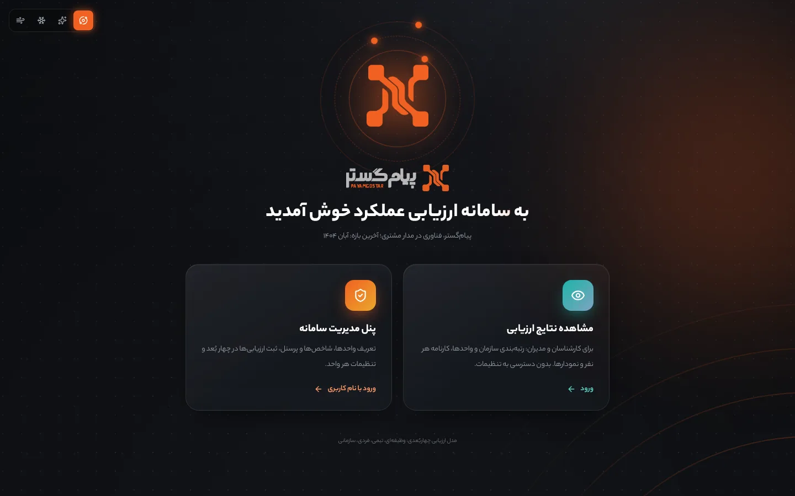
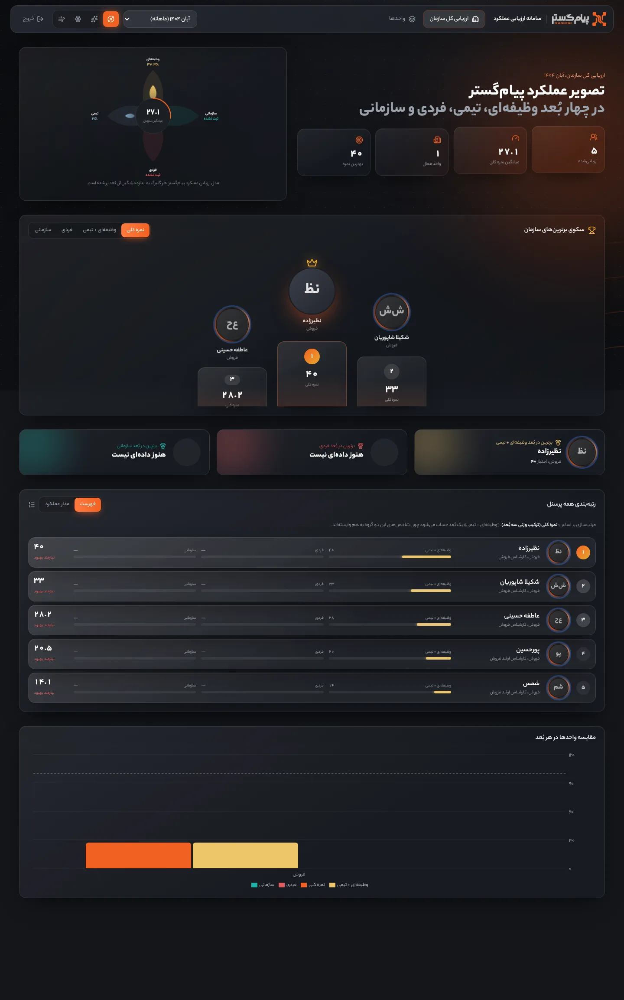
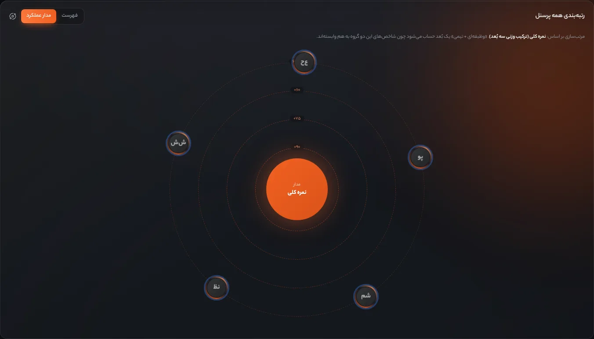
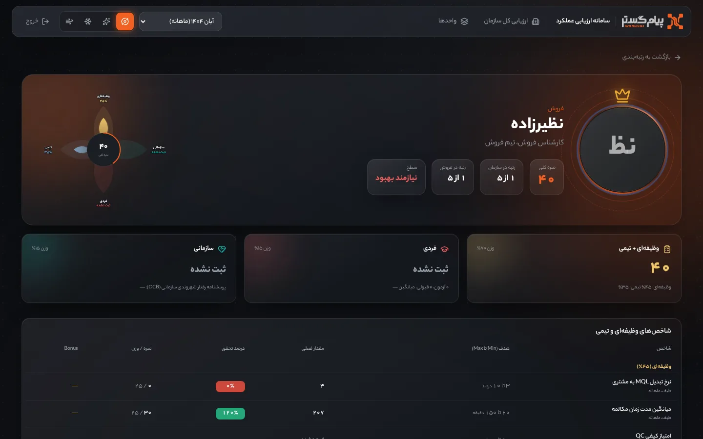
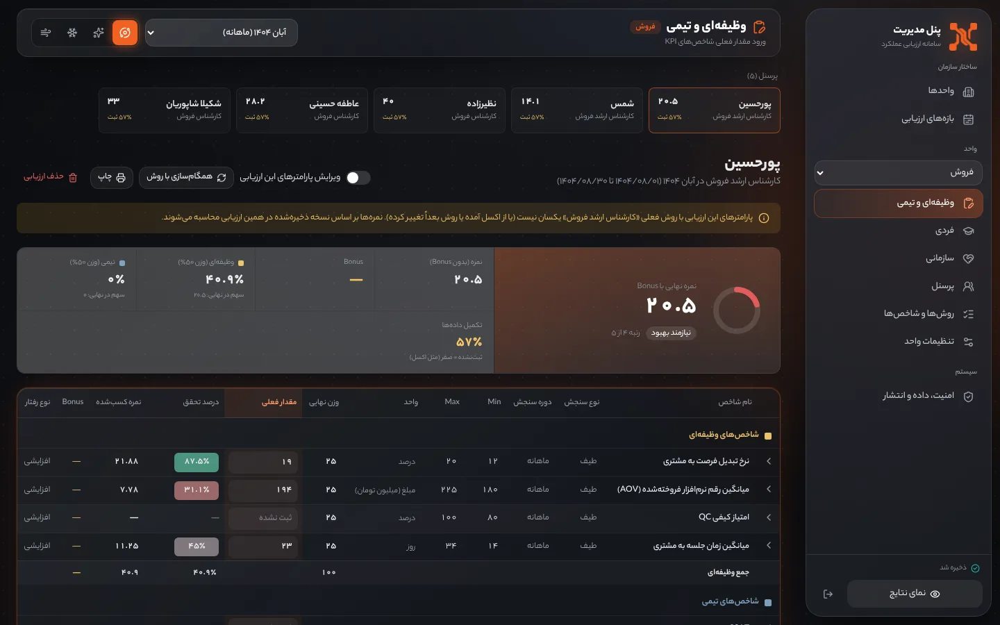
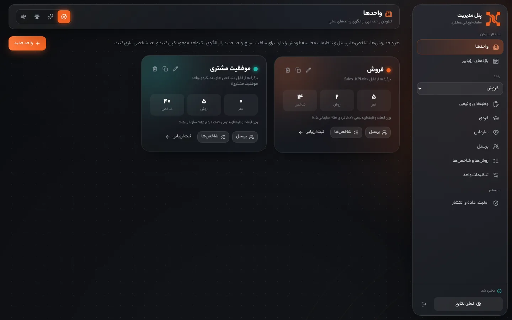

<div dir="rtl">

<p align="center">
  
</p>

<h1 align="center">سامانه ارزیابی عملکرد پیام‌گستر (Personal KPI)</h1>

<p align="center">
ارزیابی عملکرد پرسنل در چهار بُعد <b>وظیفه‌ای، تیمی، فردی و سازمانی</b>، برای همه واحدهای سازمان.<br>
یک فایل HTML تکی که بدون نصب، سرور یا اینترنت در مرورگر اجرا می‌شود.
</p>

<p align="center">
  
</p>

## فهرست

- [اجرای سریع](#اجرای-سریع)
- [ورود و نقش‌ها](#ورود-و-نقشها)
- [مدل ارزیابی چهاربُعدی](#مدل-ارزیابی-چهاربعدی)
- [امکانات](#امکانات)
- [منطق محاسبه شاخص‌ها](#منطق-محاسبه-شاخصها)
- [واحدها و داده‌های اولیه](#واحدها-و-دادههای-اولیه)
- [ذخیره داده و انتشار برای پرسنل](#ذخیره-داده-و-انتشار-برای-پرسنل)
- [تصاویر](#تصاویر)
- [توسعه](#توسعه)
- [ساختار مخزن](#ساختار-مخزن)
- [موارد باز و نیازمند تأیید](#موارد-باز-و-نیازمند-تأیید)
- [تاریخچه نسخه‌ها](#تاریخچه-نسخهها)

## اجرای سریع

فایل [`release/samane-arzyabi.html`](release/samane-arzyabi.html) را دانلود کنید و با **Chrome** یا **Edge** باز کنید. هیچ نصب یا اتصال اینترنتی لازم نیست.

> اگر نسخه ۱ را قبلاً در همان مرورگر استفاده کرده‌اید، داده‌هایتان خودکار به واحد «فروش» در ساختار جدید منتقل می‌شود.

## ورود و نقش‌ها

| نقش | دسترسی | ورود |
|---|---|---|
| کارشناسان و مدیران | فقط مشاهده نتایج: ارزیابی کل سازمان، واحدها، صفحه هر نفر. بدون هیچ تنظیماتی | بدون رمز |
| مدیر سامانه | همه تنظیمات و ثبت ارزیابی‌ها، به تفکیک هر واحد | نام کاربری `admin`، رمز `aA123456` |

رمز عبور از «پنل مدیریت ← امنیت، داده و انتشار» قابل تغییر است.

> **نکته امنیتی:** سامانه کاملاً سمت مرورگر اجرا می‌شود و سرور ندارد. رمز فقط جلوی ورود اتفاقی به پنل را می‌گیرد و جایگزین امنیت سرور نیست. فایل مدیریتی را نزد مدیر سامانه نگه دارید و به پرسنل فقط «نسخه انتشار» بدهید.

## مدل ارزیابی چهاربُعدی

برگرفته از [مدل مدیریت عملکرد، دی ۱۴۰۴](docs/source-files/مدل_مدیریت_عملکرد_دی_1404.pdf):

| بُعد | سنجه | رنگ |
|---|---|---|
| **وظیفه‌ای** | شاخص‌های عملکردی (KPI) جوهره اصلی شغل | زرد `#EEC56A` |
| **تیمی** | شاخص‌های تیمی و کیفیت خدمات | خاکستری‌آبی `#7FA3C0` |
| **فردی** | آزمون‌های پیام‌گستر (به تفکیک سرفصل و بازه) و پرسشنامه صلاحیت فردی | قرمز `#E35D5D` |
| **سازمانی** | رفتار شهروندی سازمانی (OCB) | فیروزه‌ای `#1DB5A8` |

- وظیفه‌ای و تیمی چون به هم وابسته‌اند، در رتبه‌بندی **یک بُعد** حساب می‌شوند؛ پس مرتب‌سازی «سه‌گانه» است: وظیفه‌ای+تیمی، فردی، سازمانی (به‌علاوه نمره کلی).
- **نمره کلی** = ترکیب وزنی سه بُعد. وزن پیش‌فرض ۷۰ / ۱۵ / ۱۵ و برای هر واحد جداگانه قابل تغییر است.
- **نمره فردی** = ترکیب وزنی میانگین درصد آزمون‌ها (پیش‌فرض ۷۰٪) و نمره صلاحیت فردی (۳۰٪). حد قبولی آزمون پیش‌فرض ۷۰٪.
- **نمره سازمانی** = میانگین موارد پرسشنامه (هر مورد از ۱۰۰).
- بُعدی که هنوز ثبت نشده، بسته به تنظیمات واحد یا از نمره کلی کنار گذاشته می‌شود (نرمال‌سازی روی ابعاد ثبت‌شده) یا صفر حساب می‌شود.

## امکانات

### صفحه نتایج (کارشناسان و مدیران)
- **ارزیابی کل سازمان:** نمودار گلبرگی چهاربُعدی میانگین سازمان، آمار کلیدی، سکوی سه نفر برتر با عکس، «برترین هر بُعد»، رتبه‌بندی کل پرسنل و مقایسه واحدها در هر بُعد
- **دو نمای رتبه‌بندی:** فهرست با نوار سه بُعد برای هر نفر، و «مدار عملکرد» که افراد را بر اساس سطح نمره روی مدارهای چرخان نشان می‌دهد
- **مرتب‌سازی:** نمره کلی، وظیفه‌ای+تیمی، فردی، سازمانی
- **صفحه هر واحد:** گلبرگ میانگین واحد، سکو، رتبه‌بندی، نقشه رنگی تحقق شاخص‌ها و تحلیل‌ها
- **صفحه اختصاصی هر نفر:** تصویر با افکت (کم‌رنگ و محو، با رفتن موس بزرگ‌تر و شفاف‌تر) و چرخش سه‌بعدی، رتبه در سازمان و واحد، کارت سه بُعد، جدول کامل شاخص‌ها، آزمون‌ها و روند در بازه‌ها

### پنل مدیریت (به تفکیک واحد)
- **واحدها:** افزودن واحد جدید با **کپی از الگوی واحدهای موجود** (روش‌ها، شاخص‌ها، پله‌ها، وزن ابعاد و تنظیمات؛ پرسنل اختیاری)، ویرایش نام و رنگ، حذف
- **بازه‌های ارزیابی:** ماهانه، فصلی، شش‌ماهه، سالانه یا دلخواه (تاریخ شمسی)، مشترک بین واحدها
- **وظیفه‌ای و تیمی:** ثبت مقدار فعلی شاخص‌ها با همان منطق فایل اکسل
- **فردی:** جدول نمره هر سرفصل آزمون برای همه پرسنل، صلاحیت فردی، و ثبت آزمون‌های اضافه (چند آزمون در یک سرفصل، سقف نمره دلخواه، تاریخ)
- **سازمانی:** نمره موارد پرسشنامه رفتار شهروندی برای هر نفر
- **پرسنل:** افزودن کارشناس با تصویر (خودکار مربعی و ۳۲۰ پیکسل می‌شود)، عنوان شغلی، تیم و روش ارزیابی
- **روش‌ها و شاخص‌ها:** شاخص، نوع سنجش، دوره، Min، Max، واحد، وزن، نوع رفتار، جدول پله‌ها، نحوه Bonus
- **تنظیمات واحد:** وزن ابعاد، سرفصل‌های آزمون، حد قبولی، موارد پرسشنامه سازمانی، گروه‌های شاخص و وزنشان، انواع سنجش و رفتار، سقف تحقق، درصد Bonus، سطح‌بندی عملکرد
- **امنیت، داده و انتشار:** تغییر رمز، پشتیبان و بازیابی JSON، اتصال به فایل پایگاه داده روی دیسک، ساخت نسخه انتشار، بازگشت به داده‌های اولیه

### طراحی
- هویت بصری پیام‌گستر: رنگ سازمانی `#F26122`، لوگو و گرید نقطه‌ای کارت برند، فونت **یکان بخ (Yekan Bakh FaNum)**
- طراحی شیشه‌ای معلق در فضای خلأ با عمق؛ هر کارت با رفتن موس بزرگ‌تر می‌شود و جلو می‌آید
- سه فضای پس‌زمینه که با حرکت موس جابه‌جا می‌شوند: **مدار**، **کهکشان نقطه‌ای**، **شیشه مات**
- حرکت در همه بخش‌ها (ورود صفحات، شمارش اعداد، باز شدن گلبرگ‌ها، جابه‌جایی رتبه‌ها) با دکمه **آرام کردن حرکت‌ها** و احترام به تنظیم «کاهش حرکت» سیستم‌عامل

## منطق محاسبه شاخص‌ها

برگرفته از فرمول‌های [`Sales_KPI.xlsx`](docs/source-files/Sales_KPI.xlsx). پیاده‌سازی: [`src/lib/engine.ts`](src/lib/engine.ts)

| مورد | فرمول |
|---|---|
| نسبت تحقق | `(مقدار − Min) ÷ (Max − Min)`؛ برای رفتار کاهشی `(Max − مقدار) ÷ (Max − Min)` |
| درصد تحقق | نسبت × ۱۰۰، محدود به ۰ تا سقف تحقق (پیش‌فرض ۱۲۰٪) |
| نمره طیفی | `min(max(r, 0), 1.2) × وزن` |
| نمره پله‌ای | زیر Min صفر، وگرنه نمره پله متناظر (معادل VLOOKUP تقریبی) تا سقف نمره |
| نمره موردی | `وزن × تعداد`؛ در رفتار کاهشی (مثل SLA) به‌صورت کسر امتیاز، و خارج از جمع وزن ۱۰۰ |
| Bonus | ۲۰٪ وزن در تحقق کامل، یا انتقال مازاد وزن (ردیف AOV)، یا امتیاز پله‌های مازاد بر Max |
| درصد گروه | `Σ نمره ÷ Σ وزن × ۱۰۰` برای گروه وظیفه‌ای و تیمی |
| نمره KPI | میانگین وزنی درصد گروه‌ها (پیش‌فرض ۵۰/۵۰) + Bonus (بسته به «مبنای رتبه‌بندی») |

## واحدها و داده‌های اولیه

| واحد | منبع | محتوا |
|---|---|---|
| **فروش** | [`Sales_KPI.xlsx`](docs/source-files/Sales_KPI.xlsx) | دو روش (کارشناس فروش، کارشناس ارشد فروش)، ۵ نفر و ارزیابی آبان ۱۴۰۴، بدون تغییر نسبت به نسخه ۱ |
| **موفقیت مشتری** | [`شاخص_های_عملکردی_واحد_موفقیت_مشتری.xlsx`](docs/source-files/شاخص_های_عملکردی_واحد_موفقیت_مشتری.xlsx) | پنج روش: امور مشتریان، کارشناس آموزش و پشتیبان، تحلیلگر کسب‌وکار، مدیر پروژه، اکانت منیجر؛ پله‌های حجم فروش و نرخ تمدید از برگه «پله های CS» |

## ذخیره داده و انتشار برای پرسنل

- داده‌ها در **IndexedDB مرورگر** همان کامپیوتر ذخیره می‌شود. در Chrome و Edge می‌توان سامانه را به یک فایل JSON روی دیسک هم وصل کرد تا هر تغییر خودکار در آن ذخیره شود.
- برای اینکه پرسنل نتایج را روی سیستم خودشان ببینند: «پنل مدیریت ← امنیت، داده و انتشار ← **ساخت نسخه انتشار**». خروجی یک فایل HTML فقط‌خواندنی است که داده‌های فعلی داخلش است، فقط صفحه نتایج را دارد و نام کاربری و رمز در آن نیست. هر بار نتایج تغییر کرد، نسخه جدید بسازید.
- به‌طور منظم از «دریافت پشتیبان (JSON)» استفاده کنید. پشتیبان‌های نسخه ۱ هم قابل بازیابی‌اند.

## تصاویر

| ارزیابی کل سازمان | مدار عملکرد |
|---|---|
|  |  |
| **صفحه هر نفر** | **پنل مدیریت: وظیفه‌ای و تیمی** |
|  |  |
| **پنل مدیریت: واحدها** | |
|  | |

## توسعه

```bash
npm install
npm run dev      # اجرای محلی
npm run build    # بررسی TypeScript و ساخت خروجی تک‌فایلی در dist/index.html
```

پس از ساخت، برای به‌روزرسانی نسخه آماده اجرا، `dist/index.html` را در `release/samane-arzyabi.html` کپی کنید.

**فناوری‌ها:** React 18، TypeScript، Vite 5، Tailwind CSS 3، Framer Motion، Recharts، Zustand، IndexedDB (idb-keyval)، SheetJS، jalaali-js، lucide-react، vite-plugin-singlefile

## ساختار مخزن

```
release/
  samane-arzyabi.html     نسخه ساخته‌شده و آماده اجرا
src/
  App.tsx                 پوسته‌های ورود، نمایش نتایج و پنل مدیریت
  lib/
    types.ts              مدل داده (واحد، پرسنل، بازه، ارزیابی، ابعاد)
    engine.ts             موتور محاسبه KPI و نمره چهاربُعدی و رتبه‌ها
    seed.ts, seed-cs.json داده اولیه از دو فایل اکسل
    store.ts              وضعیت، ورود مدیر، ذخیره‌سازی، مهاجرت v1 به v2، نسخه انتشار
    hooks.ts, jalali.ts, excel.ts, image.ts
  components/
    Space.tsx             پس‌زمینه‌های سه‌گانه، پارالاکس، لوگو
    People.tsx            آواتار، گلبرگ چهاربُعدی، سکو، مدار عملکرد، فهرست رتبه
    ui.tsx, Viz.tsx, KpiEditor.tsx
  pages/
    Entry.tsx             صفحه خوش‌آمد و ورود گرافیکی
    viewer/               OrgView، UnitView، PersonView
    admin/                AdminUnits، DimEntry (فردی و سازمانی)، AdminSystem
    Evaluate, Periods, Employees, Templates, Settings, Analytics
  fonts/                  یکان بخ
  assets/                 لوگو و آیکون پیام‌گستر
docs/
  source-files/           اکسل‌های شاخص و PDF مدل مدیریت عملکرد
  brand/                  تصاویر هویت بصری پیام‌گستر
  screenshots/            تصاویر این راهنما
  ui-ux-pro-max-SKILL.md  راهنمای طراحی رابط استفاده‌شده
```

## موارد باز و نیازمند تأیید

- **وزن ابعاد در نمره کلی:** در فایل مدل مدیریت عملکرد عددی نیامده؛ فعلاً ۷۰/۱۵/۱۵.
- **پله‌های حجم فروش در اکسل موفقیت مشتری** (۲۵۰۰ تا ۵۰۰۰) با Min و Max تومانی (یک تا سه میلیارد) هم‌واحد نیستند؛ عیناً وارد شده‌اند و در نتیجه هر فروشی بالاترین پله را می‌گیرد.
- **اکانت منیجر:** Min و Max شاخص «میانگین زمان انجام کار در کارتابل» در اکسل «؟؟؟» است و صفر گذاشته شد.
- **«میانگین نمرات شاخص فردی کارشناسان»** جدول پله نداشت؛ پله نمونه دارد (در سامانه با برچسب «پله نمونه»).
- **واحد فروش:** وزن گروه‌های وظیفه‌ای و تیمی در اکسل مشخص نبود (پیش‌فرض ۵۰/۵۰)؛ برگه «پله های فروش» در اکسل خالی بود و شاخص‌های پله‌ای مثل «فروش کل» پله نمونه دارند.
- **سرفصل‌های آزمون و موارد پرسشنامه OCB** فعلاً نمونه‌اند و از «تنظیمات واحد» قابل جایگزینی‌اند.

## تاریخچه نسخه‌ها

### ۲.۰
- طراحی کامل جدید با هویت بصری پیام‌گستر، فونت یکان بخ و رابط شیشه‌ای معلق با سه فضای پس‌زمینه
- ساختار چندواحدی و ساخت واحد جدید از الگوی واحدهای موجود؛ افزودن واحد موفقیت مشتری
- مدل چهاربُعدی و نمره کلی؛ ثبت آزمون‌ها، صلاحیت فردی و رفتار سازمانی
- صفحه ورود گرافیکی؛ جدایی صفحه نتایج از پنل مدیریت با ورود مدیر
- رتبه‌بندی با تصویر (سکو، مدار عملکرد، فهرست) و صفحه اختصاصی هر نفر
- نسخه انتشار فقط‌خواندنی برای پرسنل؛ مهاجرت خودکار داده‌های نسخه ۱

### ۱.۰
- سامانه ارزیابی کارشناسان فروش بر پایه `Sales_KPI.xlsx`: ثبت ارزیابی، بازه‌ها، پرسنل و روش‌ها، داشبورد، تحلیل، تنظیمات، پشتیبان و خروجی اکسل

</div>
